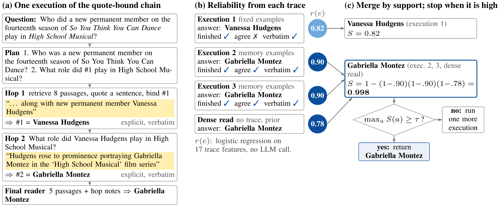

# SupportChain

Code for **SupportChain: Trace-Calibrated Aggregation of Quote-Grounded Reasoning Chains for Multi-Hop RAG with Small Readers**.

SupportChain answers multi-hop questions with a 9B reader and plain dense retrieval, without building an index:

1. **Quote-bound chain.** The reader splits the question into single-hop sub-questions. Each hop retrieves passages and
   binds its answer to a sentence quoted from one of them. A final reader (HippoRAG 2's reading prompt, unchanged) sees
   passages and the hop notes.
2. **Trace reliability.** A logistic regression over features of the execution trace (completion and agreement, quote
   evidence, retrieval scores, plan shape) estimates whether an execution is right. It calls no LLM.
3. **Support merging.** Executions that reach the same answer are pooled by noisy-OR,
   `S(a) = 1 - prod_{e in G(a)} (1 - r(e))`, and the answer of the most reliable execution in the best group is returned.
   Executions can be added only while support is below a threshold.

The **full method** merges four executions: the dense read, the single execution (fixed plan examples), and two plan
executions whose plan examples come from a memory of the chain's own right plans on training questions.



## Results

Test F1 under the HippoRAG 2 protocol (1,000 questions per dataset), every system with Qwen3.5-9B and NV-Embed-v2:

| System | MuSiQue | 2Wiki | HotpotQA | NQ | PopQA |
|---|---|---|---|---|---|
| Dense read (top 5) | 40.7 | 55.4 | 75.0 | 58.0 | 55.7 |
| IRCoT | 43.5 | 59.7 | 75.6 | - | - |
| HippoRAG 2 | 45.8 | 72.3 | 74.7 | 58.4 | 55.8 |
| Single execution | 59.8 | 78.2 | 76.5 | 59.8 | 57.4 |
| **Full method** | 63.0 | 78.6 | 78.0 | 61.4 | 57.4 |
| On demand | 62.9 | 78.2 | 77.8 | 62.1 | 57.5 |

`scripts/evaluate.py` recomputes these numbers, the merge-rule comparison, the support-threshold curve and the
reliability-model analyses from the run records.

## Repository layout

```
src/supportchain/
  chain_agent.py        quote-bound chain, dense read, plan memory (PlanPool)
  support.py            reliability features, logistic model, support merging
  textmatch.py          answer normalisation and matching
  binding_scorer.py     hop-candidate features; learned hop scorer (chain variant)
  llm.py                cached, logged client for the local OpenAI-compatible reader
  data.py, splits.py    datasets and the development/training splits
  embedding_service.py, nv_adapter.py, prepare_*_embeddings.py, calibrate_dense.py   NV-Embed-v2 vectors
  baseline_dense.py, baseline_ircot.py, baseline_hipporag.py, hipporag_*.py         same-reader baselines
scripts/
  run_chain.py          one run (chain or dense read) on one split
  fit_support_model.py  fit the reliability model on train-S runs
  build_plan_memory.py  build a plan memory from the chain's own right plans
  run_llm_selector.py   control: the reader picks among the candidate answers
  run_ircot_test.py, score_hipporag_test.py, prepare_test_embeddings.py
  fit_binding_scorer.py fit the learned hop scorer (chain variant)
  evaluate.py           all merged results and analyses, CPU only
  run_experiments.sh    every experiment of the paper, stage by stage
  serve_local_llm.sh    vLLM server for the reader
  analysis/             root causes and binding errors on MuSiQue development questions
configs/
  support/              fitted reliability models (MuSiQue, 2Wiki, HotpotQA; NQ and PopQA use HotpotQA's)
  plan_memory/          plan memories, rounds 1 and 2, per multi-hop dataset
  scorers/              fitted hop scorer (chain variant)
  models.json           model revisions; splits.json split settings; env/ exact environments
tests/                  offline unit tests (no model, no GPU)
```

## Setup

The experiments ran on one GPU with three Python 3.12 environments, listed exactly in `configs/env/`:

- `envs/main`: chain runs, fitting and evaluation (`numpy`, `jsonschema`, `filelock`, `pyarrow`).
- `envs/embed`: NV-Embed-v2 and the HippoRAG 2 baseline (`configs/env/embed.lock`, plus HippoRAG installed editable).
- `envs/serve`: vLLM 0.17.1 for the reader.

External resources, placed under the repository root:

| Path | Source |
|---|---|
| `external/HippoRAG` | https://github.com/OSU-NLP-Group/HippoRAG at commit `d5c8329422e0a0b834a15874545cb6a74b4f9b26` (prompts, scorer and the baseline; used unmodified) |
| `models/Qwen/Qwen3.5-9B` | Hugging Face `Qwen/Qwen3.5-9B`, revision in `configs/models.json` |
| `models/nvidia/NV-Embed-v2` | Hugging Face `nvidia/NV-Embed-v2`, revision in `configs/models.json` |
| `data/hipporag2/<dataset>.json`, `<dataset>_corpus.json` | Hugging Face dataset `osunlp/HippoRAG_2` (musique, 2wikimultihopqa, hotpotqa, nq_rear, popqa) |
| `data/raw/musique/extracted/data/musique_ans_v1.0_train.jsonl` | MuSiQue training set |
| `data/raw/2wikimultihop/extracted/train.json` | 2WikiMultiHopQA training set |
| `data/raw/hotpotqa/distractor/*.parquet` | Hugging Face dataset `hotpotqa/hotpot_qa`, distractor training split |

Services: the reader on `127.0.0.1:18080` and the embedding service on `127.0.0.1:18081`.

```bash
scripts/serve_local_llm.sh &                                       # reader, thinking off, greedy by default
PYTHONPATH=src envs/embed/bin/python -m supportchain.embedding_service &
```

## Running

```bash
scripts/run_experiments.sh prepare     # splits (seed 42) and NV-Embed-v2 vectors
scripts/run_experiments.sh fit         # train-S runs, reliability models, plan memories
scripts/run_experiments.sh dev         # dev-A runs and baselines
scripts/run_experiments.sh test        # the four executions, resampled executions, reader-picks control
scripts/run_experiments.sh baselines   # IRCoT and HippoRAG 2 with the same reader and embedder
scripts/run_experiments.sh variants    # chain design variants
scripts/run_experiments.sh evaluate    # every table: python scripts/evaluate.py --split test --refit
```

The fitted reliability models and the plan memories of the paper are included, so `fit` can be skipped; refitting on the
same training runs gives the same weights. A single run looks like this:

```bash
PYTHONPATH=src envs/main/bin/python scripts/run_chain.py --dataset musique --split test --tag single --candidates 1
```

Each run writes `runs/chain/<split>/<dataset>/<tag>/` with `records.jsonl` (plan, hops, quotes, final answer and usage
per question), `scored.json` and `summary.json`. Every LLM call is cached under `runs/cache/llm`, so a repeated command
reproduces its outputs. No gold field is read while answering; gold labels only score the saved records.

## Where each result comes from

| Paper | Runs | Output of `scripts/evaluate.py` |
|---|---|---|
| Section 5: main results and cost | `a0`, `single`, `selfmem_answer`, `selfmem2_answer`, baselines | `main`, `threshold_curve` |
| Section 6.1: how to merge | the above, `sc07_*`, `llm_select` | `merge_rules`, `all_merge_comparisons` |
| Section 6.2: the reliability model | train-S `single_fit`, `a0_fit` (MuSiQue also `cand3_fit_reader`) | `reliability`, `reliability_refit` (`--refit`) |
| Section 6.2 and appendix: where executions come from | `sc07_*`, `sc03_*` | `sources` |
| Section 6.3: chain design | `ctx_notes`, `ctx_passages`, `khop4`, `cand3`, `knn_single`, `cand3_s1500_bt` | `chain_variants` |
| Appendix: development results | dev-A runs | run with `--split dev-A` |
| Appendix: root causes of binding errors | MuSiQue dev-A `single` | `scripts/analysis/root_cause.py`, `binding_errors.py` |
